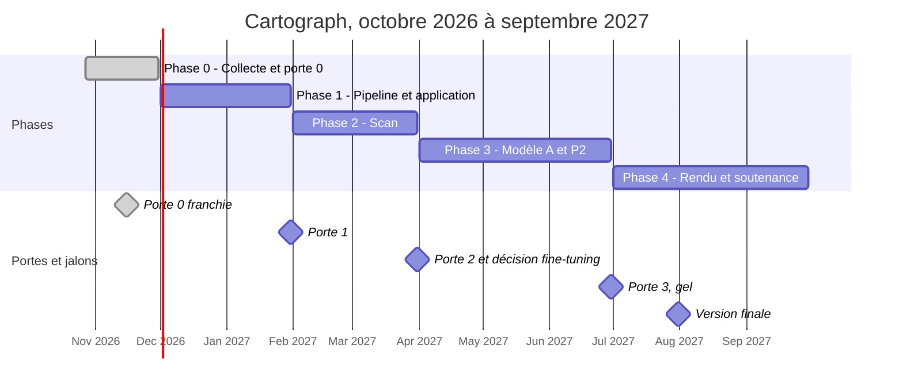

# Calendrier

*Rédigé le 15 novembre 2026. Révisé à chaque porte franchie (section « Révisions ») ; rythme suivi chaque mois avec `inv suivi` (dossier [suivi](suivi/)).*

Le projet avance par lots (feuille de route locale `docs/plans/roadmap-lots.md`). Le temps de travail varie : parfois une journée par weekend, parfois tous les jours de la semaine. Le calendrier part donc du rythme mesuré, avec un scénario bas pour décider quoi couper.

## Phases et portes

| Phase | Période | Lots (ordre de la feuille de route) | P1 ouverts | Porte de sortie |
| --- | --- | --- | --- | --- |
| 0. Collecte et porte 0 | 27 octobre au 30 novembre 2026 | collecte en route, tests T1 à T9, GOV-04, GOV-05 | 2 | Porte 0 : franchie le 15 novembre 2026 |
| 1. Pipeline et application | décembre 2026 et janvier 2027 | CI-01, FND-02, STO-02, DBT-01 à DBT-06, QUA-01, QUA-02, CI-02, GOV-01, GOV-03, SUR-02 ; APP-T1, APP-01, APP-02, APP-04 | 19 | Porte 1, 31 janvier 2027 : `dbt build` vert en CI avec ses tests, application lisant les marts |
| 2. Scan | février et mars 2027 | SCN-02, EMB-01, EMB-02, SCN-01, SCN-03, SCN-D1 ; OCR-01, OCR-02 (P2) | 6 | Porte 2, 31 mars 2027 : scan évalué sur le jeu de test, arrêt du scan, décision sur le fine-tuning |
| 3. Modèle A et P2 | avril à juin 2027 | MLA-01, NLP-01, MLA-02, MLA-03, APP-05, APP-03 ; GOV-02, DOC-02 à DOC-04 ; P2 ensuite | 10 | Porte 3, 30 juin 2027 : tous les lots P1 cochés, gel des fonctionnalités |
| 4. Rendu et soutenance | juillet à septembre 2027 | rapport, démonstration, répétition | — | Version finale fin juillet ; août pour la répétition ; soutenance en septembre (date à confirmer par l'école) |

À chaque porte non franchie, les bonus sont supprimés avant de toucher au cœur : P3 de bas en haut, puis P2.

## Rythme mesuré

Du 27 octobre au 15 novembre 2026 (2,9 semaines) : 9 jours travaillés, soit environ 3 jours par semaine, et 20 lots P1 cochés, soit environ 2 lots par jour travaillé. Ces premiers lots sont surtout des mesures et des documents ; les lots qui restent (dbt, scan, modèle) sont plus longs. Le calendrier compte donc un lot pour une journée de travail, comme la spec maîtresse (« lots d'un weekend »).

## Scénarios jusqu'au gel (30 juin 2027)

Du 16 novembre 2026 au 30 juin 2027 : 32 semaines ; 37 lots P1 et 12 lots P2 restent ouverts (au 15 novembre 2026).

| Scénario | Jours disponibles | Ce qui tient | Décision |
| --- | --- | --- | --- |
| Rythme observé, environ 3 jours par semaine | environ 100 | P1 (37 jours) et P2 (12 jours), marge pour une partie des P3 | Calendrier ci-dessus tenu ; P3 à partir de juin si le cœur est stable |
| Rythme bas, une journée par weekend | environ 32 | Pas tous les P1 | P2 et P3 coupés ; il faut au moins 1,2 jour par semaine en moyenne pour finir le cœur |

Le rapport mensuel compare les jours travaillés du mois à ces deux rythmes. Deux mois de suite au rythme bas déclenchent la coupe des P2.

## Ressources

| Ressource | Usage | Limite connue |
| --- | --- | --- |
| Poste personnel, Windows et WSL, sans GPU | développement, application, évaluation du scan | aucun GPU : embeddings sur CPU |
| Runners GitHub d'un dépôt public (4 processeurs, 16 Go) | collecte quotidienne, index d'embeddings (15 minutes au plus, test T9) | 6 h par job, 14 Go de disque |
| Releases GitHub (`cartograph-data` public, `cartograph-prices` privé) | catalogue public, prix bruts privés | fichier de Release sous 2 Gio |
| cron-job.org, healthchecks.io | déclenchement quotidien, alertes | comptes gratuits |
| Hugging Face Hub | modèle et index d'embeddings (EMB-02) | compte à créer, conditions à lire |
| Kaggle (GPU) | fine-tuning seulement, si décidé fin mars 2027 (P3) | quota à vérifier |

Coût : 0 €. Les minutes Actions sont gratuites pour un dépôt public ; leur équivalent payant et leur énergie sont dans les rapports de [suivi](suivi/).

## Révisions

À chaque porte : date réelle de passage, rythme mesuré depuis la porte précédente, dates des phases suivantes recalées, lots coupés s'il y en a. Les versions précédentes restent dans l'historique Git.

| Date | Porte | Changement |
| --- | --- | --- |
| 15 novembre 2026 | 0 | Calendrier reconstruit (GOV-04) ; porte 0 franchie avant la date limite de fin novembre ; portes 1 à 3 fixées au 31 janvier, 31 mars et 30 juin 2027 (validées par Antoaneta, recalées à chaque porte) |
