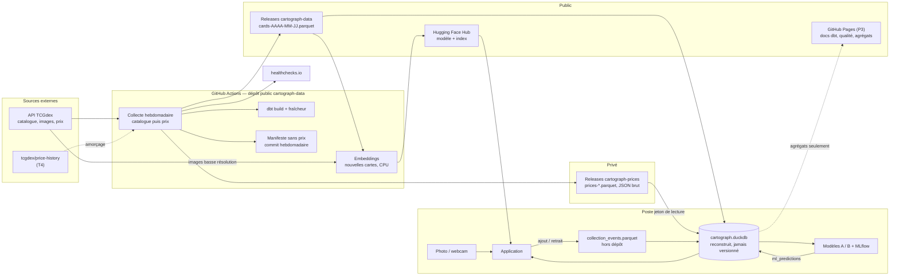
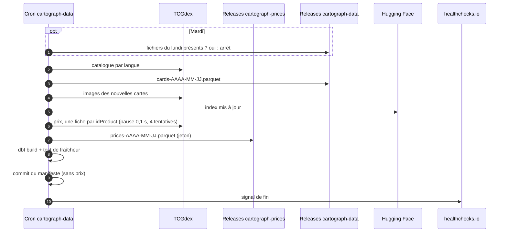

# Cadrage des flux et de l'application

28 octobre 2026 · @antoaneta · validé le 28 octobre 2026

La spec maîtresse décrit la couche technique (outils, choix, exigences). Ce document la
complète par la vue des flux : quelle donnée part d'où, quand, vers où, qui la lit, et de
quel côté de la frontière public / privé elle passe. Il fixe aussi le contenu de
l'application avant le choix de l'outil.

## Vue d'ensemble

## Les flux

| Id | Flux | Déclencheur | Entrée | Sortie | Visibilité | Lots |
| --- | --- | --- | --- | --- | --- | --- |
| FX1 | Catalogue | Cron hebdomadaire, `workflow_dispatch` | `/v2/{lang}/cards` + une fiche par carte, par langue de `LANGUAGES` | `cards-AAAA-MM-JJ.parquet` dans la Release `data-AAAA-MM` | Public (MIT, sans images) | COL-01, COL-02, STO-01 |
| FX2 | Prix | Cron hebdomadaire (lundi 03:17 UTC, rattrapage mardi), `workflow_dispatch` | Une fiche par `idProduct` Cardmarket (européen commun, japonais à part) | `prices-AAAA-MM-JJ.parquet`, JSON brut mensuel | Privé uniquement | COL-01, COL-02, STO-01, STO-03 |
| FX3 | Amorçage de l'historique | Manuel, une fois (si T4 concluant) | tcgdex/price-history | Snapshots de prix antérieurs au premier jour de collecte | Privé | COL-T4 |
| FX4 | Index d'embeddings | Initial : manuel ; ensuite : après chaque FX1 | Dernier catalogue, images basse résolution (temporaires) | Index + révision du modèle sur Hugging Face | Public (vecteurs, pas d'images) | SCN-* |
| FX5 | Surveillance | Fin de chaque FX2 | Résultat de la collecte, `dbt build` | Signal healthchecks.io, manifeste commité, résumé d'exécution | Public, sans prix | SUR-01, QUA-02 |
| FX6 | Reconstruction | `inv rebuild` en local ; échantillon en CI | Releases publiques et privées, `collection_path` | `cartograph.duckdb` (staging, intermediate, marts) | Local | STO-02, DBT-* |
| FX7 | Collection | Validation d'un scan ou saisie dans l'application | Événement : carte, langue, finition, état, date, prix payé (facultatif), origine (scan / manuel) | Journal `collection_events.parquet` local, par ajout seulement ; dbt en déduit l'état et la valeur | Local (exemple versionné) | DBT-05, APP-* |
| FX8 | Scan | Photo envoyée dans l'application | Photo, index Hugging Face | 5 candidates avec score ; carte validée → FX7 | Local | SCN-* |
| FX9 | Prédiction | Manuel, après reconstruction | Marts | `ml_predictions`, expériences MLflow | Local ; résultats agrégés publiables | ML-* |
| FX10 | Publication | Manuel ou CI (P3) | Docs dbt, tests, agrégats | GitHub Pages | Public, jamais de prix unitaire | F22 |

## Exécution hebdomadaire

## Frontière public / privé

| Donnée | Où | Public |
| --- | --- | --- |
| Code, manifeste, catalogue TCGdex | `cartograph`, `cartograph-data` | Oui |
| Index d'embeddings, révision du modèle | Hugging Face Hub | Oui |
| Agrégats, sorties des modèles, qualité | GitHub Pages, rapport | Oui, sans prix unitaire |
| Prix bruts, JSON brut | Releases `cartograph-prices` | Non |
| Logs et résumés des workflows publics | `cartograph-data` | Oui : ne contiennent aucun prix |
| Images des cartes | Machine éphémère, dossier local ignoré | Non |
| Collection, photos de test | Poste local | Non (jeu d'exemple versionné) |

Conséquence directe pour l'application : elle lit des prix, donc elle ne peut pas être
hébergée publiquement. Elle tourne en local (ou docker compose) avec le jeton de lecture.

## Application

Le contenu se décide avant l'outil : c'est lui qui conditionne la démonstration.

### Parcours de démonstration

1. **Scanner et ranger** : je photographie une carte, l'application propose 5 candidates,
   je valide la bonne, je précise état et finition (et le prix payé si je le connais) : elle
   entre dans ma collection et j'arrive sur sa fiche.
2. **Ma collection** : tout ce que je possède avec toutes les infos (set, rareté, numéro,
   prix du jour), depuis quand, combien elle vaut, comment cette valeur évolue, plus-value
   depuis l'achat, ce qui pèse le plus, ce qui manque pour compléter un set.
3. **Le marché** : quels sets et raretés montent ou baissent, quelles cartes s'écartent de
   leur prix attendu.
4. **Les coulisses** : la donnée est-elle fraîche, complète, testée ; que vaut le scan.

### Écrans proposés

| Écran | Contenu | Source | Exigences | Prio |
| --- | --- | --- | --- | --- |
| Fiche carte | Image (chargée depuis TCGdex, jamais stockée), set, rareté, numéro, historique des prix par finition, prix attendu (modèle A) avec marge d'erreur ; si la carte est possédée : indicateur de marge (voir ci-dessous) et courbe du prix depuis l'achat, avec la tendance du modèle B en pointillés si disponible | `dim_card`, `fct_price_snapshot`, `fct_collection`, `ml_predictions` | F14, F15, F16 | P1 (tendance : P3) |
| Scan | Photo (fichier ou appareil), 5 candidates et scores, validation → fiche carte | Index HF | F11, F10 | P1 |
| Ma collection | Inventaire filtrable (set, rareté, finition, état, langue) avec prix du jour ; valeur totale et courbe ; plus-value depuis l'ajout ; répartition set / rareté ; complétion par set ; historique des ajouts et retraits | `fct_collection`, `fct_collection_value`, `dim_card` | F16 | P1 |
| Marché | Tendances par set et rareté, cartes sur / sous-évaluées, recherche → fiche carte | `mart_price_trends`, `mart_price_baseline` | F17, F18 | P1 / P2 |
| Coulisses | Fraîcheur, complétude, derniers tests dbt, couverture de l'historique, résultats du scan (top-1, top-5, IC) | Tests dbt, `scan_evaluation` | F4, F7, F13 | P1 |
| Webcam | Scan continu avec vote | Index HF | F20 | P3 |

La **fiche carte** est l'écran pivot absent de la spec maîtresse : le scan, la collection et
le marché y mènent tous.

### Collection : un journal plutôt qu'un état

La collection est un journal d'événements (ajout, retrait), jamais réécrit : chaque scan
validé ou saisie ajoute une ligne. dbt en déduit l'état courant (`fct_collection`) et la
valeur jour par jour (`fct_collection_value`), en croisant la date d'entrée de chaque carte
avec `fct_price_snapshot`. On sait ainsi ce qu'on possédait à toute date passée, et la
plus-value se calcule sans rien stocker de plus. Même principe que les snapshots : ajout
seulement.

### Marge sur prix payé

Le prix payé est facultatif, saisi à l'ajout ou plus tard (événement de correction).

- **Indicateur** : marge = (prix du jour − prix payé) / prix payé, en pourcentage ; vert si
  positive (payée moins cher que sa valeur), rouge si négative. Affiché par carte (fiche,
  inventaire) et pour toute la collection (cartes avec prix payé uniquement).
- **Vision dans le temps** : courbe du prix de la carte depuis la date d'achat, avec une
  ligne horizontale au prix payé ; la zone entre les deux est verte ou rouge.
- **Tendance (P3)** : si le modèle B aboutit, prolongement à 4 semaines en pointillés,
  avec sa marge d'erreur et la mention « analyse, pas un conseil ».
- **Prix de référence** : prix de tendance Cardmarket de la finition possédée (à confirmer
  sur les champs réels en DBT-02) ; une carte sans prix du jour affiche « prix indisponible »,
  jamais 0 %.
- Le prix payé est une donnée personnelle : il reste dans le journal local, jamais publié.

### Outil : options

Exigence : un rendu professionnel, en restant en Python (seule, le weekend).

| Option | Rendu | Pour | Contre |
| --- | --- | --- | --- |
| Streamlit | Reconnaissable, « prototype » | Le plus rapide à construire | Ne répond pas à l'exigence de rendu |
| NiceGUI | Application web (Quasar, Tailwind) | Python seul ; tourne sur FastAPI, donc l'application expose aussi une API (scan, cartes, collection) dans le même processus ; composants riches (tables, ECharts, envoi de fichier) ; état et événements explicites | Moins de tutoriels que Streamlit ; webcam via un composant personnalisé (P3) |
| Dash + Dash Mantine Components | Tableau de bord soigné | Mature, graphiques Plotly | Callbacks verbeux ; moins naturel pour un parcours scan → validation → fiche |
| Reflex | Application React (Radix) | Python seul, rendu le plus moderne | Jeune, API qui change encore, compilation Node.js |
| FastAPI + frontend (HTMX ou React) | Au choix | Architecture la plus « production », API réutilisable | Deux bases de code, HTML / JS à écrire : le plus coûteux |

**Recommandation : NiceGUI.** Rendu d'application web, Python seul, et FastAPI dessous :
l'écran et l'API partagent le même code, ce qui se défend bien en soutenance (séparation
lecture DuckDB / logique / interface). Avant de figer, un prototype d'un weekend (lot
APP-T1) : la fiche carte et l'inventaire sur le jeu d'exemple, pour vérifier rendu et
productivité ; s'il déçoit, repli sur Dash Mantine.

## Décisions (28 octobre 2026)

1. Contenu de l'application : quatre parcours et écrans ci-dessus, fiche carte comme écran
   pivot (elle remplace « prix attendu et tendance pour une carte » de la page Marché).
2. Collection en journal d'événements (`collection_events.parquet`), marge sur prix payé.
3. Outil choisi au prototype APP-T1, au début de la phase application (NiceGUI
   recommandé, repli Dash Mantine). D'ici là, aucune logique dans l'interface : scan,
   lecture DuckDB et calculs (marge, valeur) vivent dans `cartograph.bin`. La webcam (P3)
   ne pèse pas dans le choix : elle tourne d'abord dans une fenêtre OpenCV sur la machine
   hôte, indépendante de l'outil.
4. Un seul workflow de collecte, hebdomadaire depuis le 29 octobre 2026 (lundi, rattrapage
   le mardi si les fichiers du lundi manquent) : catalogue, puis prix, puis embeddings des
   nouvelles cartes ; un échec du catalogue ne bloque pas les prix, collectés avec le
   catalogue précédent.
